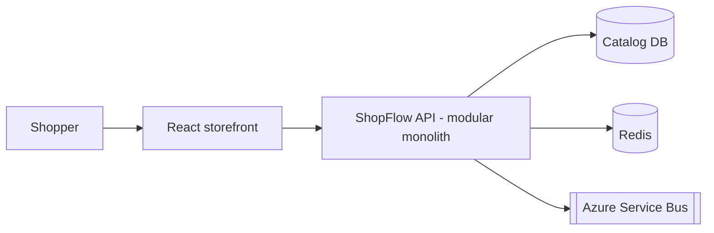

# ShopFlow

Production-grade e-commerce reference built to demonstrate architecture,
cloud, and AI engineering: .NET 10, React + TypeScript, Azure, event-driven
messaging, caching, observability, and AI-powered search.
## Architecture

## Tech stack
| Area | Choices |
|---|---|
| Backend | .NET 10, ASP.NET Core minimal APIs, EF Core |
| Frontend | React, TypeScript, Vite (planned) |
| Cloud | Azure Container Apps, Azure SQL, Redis, Service Bus (planned) |
## Getting started
Open `ShopFlow.slnx` in Visual Studio 2026, set **ShopFlow.AppHost** as the
startup project, and press F5.
## Decisions
- [ADR-0001: Modular monolith](docs/adr/0001-modular-monolith.md)
## Roadmap
See the GitHub Project board.
